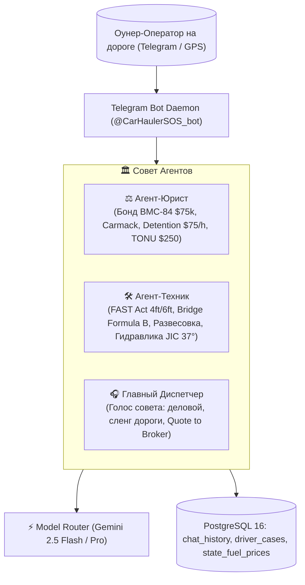
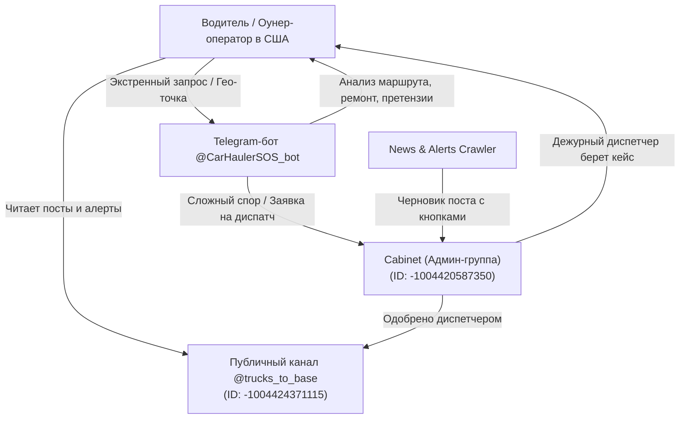

# 🚛 Грузовики на базу: Автономный AI-Диспатч & Лидогенерация

> **Единственная в США AI-диспетчерская для автовозов, говорящая на настоящем языке дороги, где водитель ВСЕГДА прав, а его деньги и CDL защищены законом.**

[](#)
[-orange.svg)](#)
[](#)
[](#)
[](#)

---

## 📌 1. Быстрые ссылки на систему (Quick Links)

| Ресурс | Ссылка | Назначение / Доступ |
| :--- | :--- | :--- |
| 📢 **Telegram-канал** | [`@trucks_to_base`](https://t.me/trucks_to_base) | Публичный канал сообщества (ID: `-1004424371115`): алерты дорог, новости, разборы споров |
| 🤖 **Telegram AI-Бот** | [`@CarHaulerSOS_bot`](https://t.me/CarHaulerSOS_bot) | Экстренная помощь на дороге (маршрут, солярка, ремонт, брокеры, свесы, претензии) |
| 👥 **Админ-кабинет (Cabinet)** | `Cabinet Admin Group` | Закрытая группа диспетчеров (ID: `-1004420587350`) для модерации постов и эскалаций |
| 📊 **Grafana Dashboard** | [Live Executive Dashboard](https://grafana.194.127.179.231.sslip.io/d/dispatch-hub-analytics/dispatch-hub3a-driver-cases-and-operations) | Аналитика выбитых средств, статистика кейсов и метрики моделей (`admin` / `GrafanaAdminSecure2026!`) |
| 📈 **Prometheus Metrics** | `http://194.127.179.231:8000/metrics` | Метрики Model Router (`gemini_requests_total`, `gemini_latency_seconds`) |
| 🛠️ **Техническая Архитектура** | [`TECHNICAL_ARCHITECTURE.md`](file:///c:/Users/Daniel/Documents/Knowledge%20Base/TECHNICAL_ARCHITECTURE.md) | Полное инженерное руководство по микросервисам, базам данных и деплою |
| 🖥️ **Хостинг / Сервер** | `194.127.179.231` (Host: `trucker-dream`) | Clouvider Cloud VPS (Ubuntu 24.04 LTS, Docker Compose Stack) |

---

## 🎯 2. Бизнес-модель и Цели Проекта

### Суровая реальность автовозного бизнеса в США
Автовозный бизнес (Car Hauling) — один из самых высокодоходных, но и самых рискованных сегментов грузоперевозок. Оунер-оператор сталкивается с постоянным давлением:
1. **Неоплачиваемый простой (Detention):** Аукционы Copart, IAAI и Manheim маринуют автовоз на гейтах по 4–6 часов, а брокеры отказываются платить.
2. **Срывы погрузки (Dry Run / TONU):** Водитель проехал 100 миль дедхеда, а лот уже продан или заблокирован.
3. **Скрытые ин-опы (Inop):** Машина заявлена как "Runs & Drives", но по факту не заводится, колеса заблокированы, а лебежение никто не оплатил.
4. **Дабл-брокеринг и мошенники:** Скамеры перепродают чужие грузы через свежие MC и крадут оплату за фрейт.
5. **Ценовой прессинг на топливо:** Разница в цене солярки между штатами и колонками достигает $0.50–$1.50 за галлон (Орегон/Калифорния $6.75–$8.40 vs Техас $3.40).
6. **Повреждения груза и поломки оборудования:** Случайная царапина на клиентском авто грозит клеймом на Carfax и взлетом страховки, а лопнувший гидравлический шланг парализует погрузку.

### Наша стратегическая цель
Создать **автономный ИИ-хаб экстренной помощи автовозчикам**, который:
- Решает реальные дорожные проблемы оунера за 60 секунд.
- Выбивает деньги с брокеров (Detention, Dry Run, Inop fee).
- Защищает водителя от штрафов DOT, весовых проверок и скамеров.
- Предоставляет расчет маршрута, топлива и проверенных мастеров в реальном времени без захардкоженных цифр.
- **Главная конверсионная цель (Future Plans):** Демонстрацией железной защиты переводить оунер-операторов на наше постоянное диспетчерское обслуживание за **фиксированную комиссию 7%**.

---

## 🏛️ 3. Архитектура «Совет Агентов» & Голос Дороги

Вместо шаблонного чат-бота систему ведет профессиональный **Совет Агентов** (Council of Agents), говорящий на аутентичном языке американских автовозчиков:



### Состав Совета:
1. **⚖️ Агент-Юрист:** Знает Carmack Amendment, условия бонда брокера BMC-84 ($75,000), регламент счетов за простой ($75/час после 2 часов бесплатного ожидания) и взыскание TONU.
2. **🛠️ Агент-Техник:** Эксперт по габаритам и оборудованию — FAST Act (23 CFR § 658.13), Federal Bridge Formula B, развесовка по осям (Steer 12–20k, Drive 34k, Trailer 34k, Gross 80,000 lbs), высоты мостов (Восток 13'6", Запад 14'0"), гидравлика JIC 37° и сварка рамп 6061.
3. **🎧 Главный Диспетчер:** Ведет диалог от лица совета. Никаких нотаций, сухой академической нудятины или выдуманных советов. Профессиональный, четкий язык американских автовозчиков (*стингер, виджик, хай-маунт, оунер, оверхэнг, деки, рэк, ин-оп, лебеда, гейт-слип, чарджить детеншен*).

### Фундаментальное правило: «Водила ВСЕГДА прав»
Совет всегда встает на сторону оунера: предлагает безопасные тактические решения, исключающие риски для CDL, штрафы DOT и потерю денег при спорах с брокерами.

---

## 📱 4. Меню и Функционал Бота (@CarHaulerSOS_bot)

Нативное меню команд Telegram (`setMyCommands`) синхронизировано со всеми сервисами:

### 1. 🛣️ `/route` — Анализ маршрута и солярки
* **Ввод:** Нажатие кнопки `📍 Отправить мою гео-точку` или ввод текста в свободном формате (`1033 Green Acres Rd, Eugene OR в Dallas TX`).
* **Геометрия и пробег:** Нормализация локаций через OpenStreetMap Nominatim и построение точного маршрута через OSRM.
* **Расход под сетап:**
  * Стингер 9-кар (Class 8): ~5.5 MPG (груженый) / ~6.5 MPG (пустой).
  * Хай-Маунт 7-кар: ~6.0 MPG.
  * Пикап + 3–4 авто Виджик: ~9.5 MPG.
* **Топливный арбитраж:** Суточный живой фид цен **AAA** по всем штатам на пути, расчет скидок по топливной карте водителя (Mudflap, RTS, TCS) и чистой себестоимости с учетом IFTA.
* **Весовые:** Вывод контрольных станций взвешивания (POE Weigh Stations) по маршруту.

### 2. 🔧 `/repair` — Мастер рядом (Свой трак / Авто клиента)
* **Прием локации:** Нативная GPS-точка из Telegram или адрес текстом.
* **Поиск мастерских:** Поиск через OpenStreetMap (Nominatim Bounded Viewbox) в радиусе происшествия.
* **Автоматическая классификация проблемы через Gemini:**
  * **Скрытый ремонт авто клиента (`cargo_stealth`):**
    * Ситуация: царапина, притертость, вмятина на перевозимой машине.
    * Протокол: Мобильный PDR (удаление вмятин без покраски), локальная микрополировка, расчет наличными/Zelle **без фиксации VIN в Carfax** и без страхового клейма. Проверка дорожной пыли и сопоставление отметок в eBOL.
  * **Поломка автовоза (`truck_rig`):**
    * Ситуация: лопнул гидравлический шланг, потек цилиндр, треснула алюминиевая аппарель.
    * Протокол: Подбор мобильных гидравлических сервисов (PIRTEK, Love's Truck Care, TA Truck Service), параметры фитингов (JIC 37° Flare, двухкосичные шланги 3000+ PSI), аргоновая сварка алюминия 6061 T6.

### 3. 🏢 `/broker` & 🚛 `/carrier` — Проверка компаний (Брокеры по MC# / Перевозчики по USDOT#)
* **Проверка брокера по MC#:**
  * Проверка активности брокера и наличия действующего бонда **BMC-84 ($75,000)**.
  * Оценка среднего срока оплаты (Days to Pay / DTP).
  * Проверка факторингового аппрува (Apex Capital, RTS Financial, OTR Capital, Triumph).
  * Выявление признаков дабл-брокеринга (бесплатная почта, недавняя смена реквизитов).
* **Проверка перевозчика по USDOT#:**
  * Статус **Operating Authority** в FMCSA (Active / Inactive / Revoked; Common/Contract/Property).
  * Страховое покрытие: наличие **$1,000,000 Auto Liability** и Cargo Insurance ($100k–$250k) через Form BMC-91X / BMC-34.
  * **Safety Rating & OOS-инспекции:** Driver Out-of-Service Rate (vs нац. средний 6.7%) и Vehicle Out-of-Service Rate (vs нац. средний 22.2%).
  * Количество траков (Power Units), водителей и статистика ДТП за последние 24 месяца.
  * Выявление рисков "компаний-хамелеонов" и New Authority (<90–180 дней), которые блокируются крупными брокерами.

### 4. ⚖️ `/overhang` — Свесы и весы (FAST Act)
* Разрешенные свесы груза в соответствии с **23 CFR § 658.13**:
  * **Стингер (Stinger-steered):** 4 фута спереди (Front Overhang) и 6 футов сзади (Rear Overhang).
  * **Обычная сцепка / Хай-Маунт / Виджик:** 3 фута спереди, 4 фута сзади.
* Габариты по высоте: 13'6" (Восточные штаты) vs 14'0" (Западные штаты / STAA).
* Ограничения веса по Federal Bridge Formula B (20,000 lbs одиночная ось, 34,000 lbs тандем, 80,000 lbs Gross).
* Главные весовые станции штата (POE / Scale Houses).

### 5. 📋 `/claim` — Претензии в 1 клик
Интерактивные шаблоны с юридически обоснованным текстом для мгновенной пересылки брокеру в блоках `<code>...</code>`:
* **Detention ($75/час):** Расчет при ожидании на погрузке/выгрузке свыше 2 часов.
* **TONU / Dry Run ($250 / $200):** Компенсация холостого пробега при срыве рейса не по вине водителя.
* **In-Op Winch Fee ($150):** Доплата за неходовой автомобиль с заблокированными колесами.

### 6. 👤 `/profile` — Сетап и топливная программа
* Сохранение типа автовоза (Стингер 9-кар, Хай-Маунт, Пикап с виджиком).
* Привязка топливной карты (Mudflap, RTS, TCS, NASTC, EFS) и персональной скидки (по умолчанию -$0.45/gal).
* Учет предпочтительного коридора и загрузки при всех последующих расчетах.

---

## 📢 5. Telegram-Экосистема, Каналы Связи & Модерация

Экосистема включает два взаимосвязанных рабочих пространства в Telegram:



### 1. Публичный канал: [`@trucks_to_base`](https://t.me/trucks_to_base) (ID: `-1004424371115`)
* **Аудитория:** Русскоязычные оунер-операторы и водители автовозов в США.
* **Контент:** Оперативные дорожные алерты (завалы на I-80, перевалы Donner Pass / Elk Mountain), рейды DOT на весах, динамика ставок RPM, разборы реальных споров с брокерами.
* **Воронка конверсии:** Демонстрация экспертности и перевод аудитории на постоянное диспетчерское обслуживание за 7%.

### 2. Админ-чат диспетчеров: `Cabinet` (ID: `-1004420587350`)
* **Центр Управления Полетами:**
  * Робот мониторит дорожные службы и генерирует черновик поста с кнопками `[✅ Опубликовать в канал]` и `[❌ Отклонить]`.
  * Диспетчер проверяет факты, фото и хештеги в один клик.
  * При одобрении пост мгновенно уходит в `@trucks_to_base`, а статус в PostgreSQL меняется на `published`.
  * Сюда же поступают заявки оунеров на подключение к диспетчерскому обслуживанию.

---

## 🏷️ 6. Унифицированная Система Хештегов Канала

Каждое сообщение в канале структурировано по 4-уровневой формуле для мгновенного поиска из кабины трака:

```text
#[Тип_сообщения] #[Трасса_или_Регион] #[Штат] #[Сетап_или_Тематика]
```

### Уровень 1: Рубрика публикации
| Хештег | Назначение |
| :--- | :--- |
| `#Алерт` | Критические дорожные инциденты, завалы, перекрытия перевалов, штормовой ветер |
| `#Весы` | Открытые weigh stations, мобильные весы DOT, облавы на овервейт/ELD |
| `#Новости` | Важные события автовоза: законы FMCSA, банкротства брокеров, правила стоянок |
| `#Ставки` | Аналитика RPM (Rate Per Mile), спрос по коридорам, аукционные коэффициенты |
| `#Погода` | Метеоусловия: блэк-айс, цепи (Chain Law), снегопады, торнадо |
| `#SOS_Совет` | Памятка водителям: формулы расчетов, споры с брокерами, юридические шаблоны |
| `#ЧерныйСписок` | Брокеры-мошенники, дабл-брокеры, аннулированные бонды BMC-84 |

### Уровень 2: Основные артерии (Interstates)
`#I80` · `#I70` · `#I10` · `#I40` · `#I95` · `#I75` · `#I15` · `#I5` · `#I81` · `#I65` · `#I35`

### Уровень 3: Штаты и регионы
- **Штаты:** `#TX` · `#CA` · `#FL` · `#PA` · `#OH` · `#IL` · `#GA` · `#NJ` · `#NC` · `#MI` · `#IN` · `#TN` · `#WY` · `#CO` · `#OR` · `#WA`
- **Регионы:** `#Midwest` · `#WestCoast` · `#EastCoast` · `#South` · `#Rockies`

### Уровень 4: Техника и специфика
`#Стингер` · `#Виджик` · `#ХайМаунт` · `#ИнОп` · `#Детеншен` · `#Тонну` · `#ТракСтоп` · `#FASTAct` · `#Манхейм` · `#Копарт`

---

## 📊 7. Контент-Стратегия и Воронка Вовлечения

На основе аналитики Grafana (**Engagement Rate = (Реакции + Репосты×2 + Комменты×3) / Просмотры**):

1. **ТОП-1: Защита денег водителя (ER 24.5%):** Разборы споров с брокерами (TQL, C.H. Robinson), чардж детеншена ($75/ч) и выбивание TONU получают на 40% больше репостов в чаты автовозников.
2. **ТОП-2: Дорожные ЧП на I-80/I-70 (ER 19.2%):** Посты про сдутые ветром автовозы в Вайоминге (Elk Mountain) и закрытые перевалы (Donner Pass) дают максимальный органический охват.
3. **ТОП-3: Развесовка и габариты (ER 17.7%):** Схемы безопасной загрузки 9-кар и 4-кар сцепки сохраняются водителями в закладки.

### Золотой 5-ступенчатый шаблон поста:
```text
[1. КРЮЧОК (Hook)]: 🚨 [Эмодзи] + [Трасса/Штат] + [Угроза деньгам или ригу в 6-8 словах]
[2. СУТЬ (Fact)]: 📌 2-3 предложения строго по фактам (что случилось, где конкретно).
[3. ДЕНЬГИ И РИСКИ (Impact)]: 💰 1-2 предложения: «Что это значит для нашего оунера».
[4. ДЕЙСТВИЕ (Action)]: 🛠️ Готовая инструкция: объезд, точка отстоя или Quote to broker.
[5. РАЗМЕТКА (Hashtags)]: 🏷️ Единая связка: #[Рубрика] #[Трасса] #[Штат] #[Сетап]
```

---

## 📌 8. Пин-Навигатор для Telegram (Текст для закрепленного сообщения)

> Ниже приведен официальный текст, предназначенный для закрепленного сообщения (PIN) в канале [`@trucks_to_base`](https://t.me/trucks_to_base):

```markdown
# 🚛 ПИН-НАВИГАТОР: КАНАЛ «ГРУЗОВИКИ НА БАЗУ» И ИИ-ДИСПЕТЧЕР @CarHaulerSOS_bot

Добро пожаловать в сообщество американского автовозного диспатча «Грузовики на базу»!

Наше главное правило на дороге: ВОДИТЕЛЬ ВСЕГДА ПРАВ.
Мы работаем по фиксированной ставке 7% и железно защищаем оунер-оператора от произвола брокеров, задержек на аукционах, штрафов DOT и скрытых комиссий.

---

### 🤖 Кто такой @CarHaulerSOS_bot?
Это ваш круглосуточный карманный Совет Агентов, подключенный напрямую к дежурному диспетчеру:
• 🛣️ Маршрут и солярка: Точный километраж OSRM под ваш сетап (Стингер 9-кар, Виджик), суточные живые цены AAA по всем штатам, скидки по топливной карте (Mudflap, RTS, TCS) и весовые станции на пути.
• 🔧 Мастер рядом: Поиск мастерских по геолокации 📍. Четкое разделение:
  - Авто клиента: Скрытый PDR (беспокрасочный ремонт) и полировка за наличку без занесения VIN в Carfax.
  - Свой трак: Мобильная гидравлика (фитинги JIC 37°, шланги 3000+ PSI), сварка 6061 рамп, роудсайд PIRTEK, Love's, TA.
• ⚖️ Свесы и весы (FAST Act): Законные свесы по 23 CFR § 658.13 (4ft спереди / 6ft сзади для Стингера, 3ft/4ft для Виджика), высоты мостов 13'6"/14'0" и весовые POE.
• 🏢 <b>Проверка компании (MC / DOT):</b> Моментальная проверка брокера по MC (бонд $75,000 BMC-84, DTP, факторинг) или перевозчика по USDOT (статус Authority, страховка $1M, OOS-рейтинг, флот).
• 📋 Претензии в 1 клик: Готовые юридические блоки для отправки брокеру: Detention ($75/ч после 2ч), TONU ($250), In-Op лебедка ($150).

---

### 🔥 Быстрые команды бота:
1. 🛣️ /route — Анализ маршрута: отправь гео-точку 📍 или напиши маршрут — получи километраж, расход солярки, скидку по карте и весовые.
2. 🔧 /repair — Мастер рядом: скинь локацию 📍 — бот найдет сервисы и даст технический или stealth-протокол.
3. 🏢 /broker [MC#] — Проверка брокера: статус бонда BMC-84, кредитный рейтинг и риски дабл-брокеринга.
4. 🚛 /carrier [DOT#] — Проверка перевозчика: статус Operating Authority, страховка $1M, OOS-инспекции и флот.
5. ⚖️ /overhang — Свесы и габариты: узнай лимиты свесов FAST Act и активные весы по штату.
6. 📋 /claim — Шаблоны претензий: готовые письма на английском для чарджа детеншена, TONU или лебедки.
7. 👤 /profile — Мой сетап: настрой трак и топливную карту для персональных расчетов.

---

### 💬 Как обращаться к боту:
• Прямая ссылка: t.me/CarHaulerSOS_bot
• Пишите в чат текстом или используйте кнопки внизу экрана:
  - «Посчитай маршрут: 1033 Green Acres Rd, Eugene OR в Dallas TX»
  - «Поцарапали дверь на клиентской Тесле в Далласе, нужен мастер за наличку без Carfax»
  - «Лопнул гидравлический шланг на верхней деке под Атлантой»
  - «Брокер TQL маринует на погрузке 3 часа, скинь клейм на детеншен»
  - «Проверь брокера MC 1045231»
  - «Проверь перевозчика USDOT 3892104»

---

### 🏷️ Навигация по каналу (Хештеги):
• Рубрики: #Новости · #Алерт · #Весы · #Ставки · #SOS_Совет
• Трассы: #I80 · #I70 · #I10 · #I40 · #I95 · #I75 · #I15 · #I5 · #I81
• Штаты: #TX · #CA · #FL · #PA · #OH · #WY · #CO · #OR · #WA · #GA
• Сетапы: #Стингер · #Виджик · #ХайМаунт · #ИнОп · #Детеншен · #FASTAct

---

### 📞 Контакты диспетчерской:
• 🤖 SOS Бот 24/7: @CarHaulerSOS_bot
• 📢 Канал новостей: @trucks_to_base
• 📊 Аналитика кейсов: grafana.194.127.179.231.sslip.io
• 🤝 Подключение на диспатч (7% фикс): Связь с администратором через бота.

Пристегните ремни. Диспетчерская «Грузовики на базу» прикрывает вашу спину! 🚛💨
```

---

## ⛽ 9. Топливный Модуль, AAA Feed & Model Router

В системе исключен любой хардкод топливных цен:
* Сервис `services/aaa_fuel_feed.py` производит парсинг официальных суточных средних цен **AAA** по всем 50 штатам + округ Колумбия и синхронизирует их с PostgreSQL (`state_fuel_prices`).
* Точность проверена реальными ценами на трассе I-5 (Chevron в Юджине, Орегон: \$6.74 фид AAA против \$6.75 на колонке).
* Маршрутизатор `services/model_router.py` с Circuit Breaker и экспоненциальным backoff обеспечивает бесперебойную работу через пул моделей: `gemini-2.5-flash` $\to$ `gemini-2.5-pro` $\to$ `gemini-1.5-flash`.
* Метрики Prometheus транслируются на порт `8000/metrics`.

---

## 🔒 10. Безопасность и GDPR-Комплаенс

Перед сохранением любого диалога или кейса выполняется санитация данных:
* Номера телефонов маскируются (`[PHONE_REDACTED]`).
* Telegram-никнеймы заменяются на `[USER_REDACTED]`.
* 17-значные VIN обрезаются до последних 6 цифр (`VIN:***012345`), предотвращая утечку данных о клиентах.
* Все взаимодействия сохраняются в PostgreSQL (`chat_history`, `driver_cases`) для контекстной памяти дежурного диспетчера.

---

## 🚀 11. Планы Развития (Future Plans)

Следующие стратегические направления сохраняются в соответствии с утвержденной дорожной картой:
1. **Масштабирование диспетчерского флота:** Привлечение оунер-операторов на постоянный диспатч за **фиксированную комиссию 7%**.
2. **Интеграция с ELD и телематикой:** Автоматический учет оставшихся часов HOS (Hours of Service) для предотвращения нарушений DOT.
3. **Прямая интеграция с Central Dispatch:** Автоматический матчинг попутных автомобилей на свободные деки автовоза в реальном времени.
4. **Финансовый арбитраж факторинга:** Интеграция API факторинговых компаний для моментальной проверки кредитного лимита брокера прямо в кабине.
