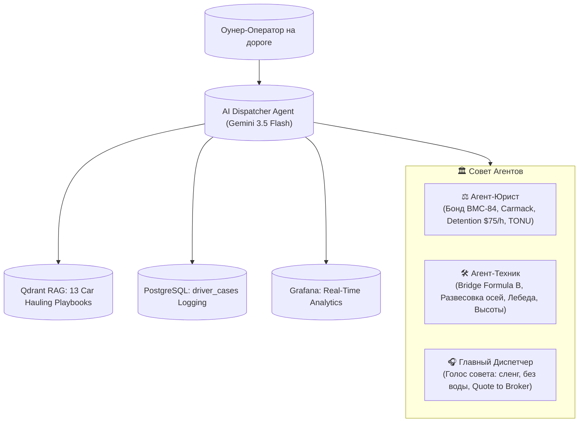

# 🚛 Грузовики на базу: Автономный AI-Диспатч & Лидогенерация

> **Единственная в США AI-диспетчерская для автовозов, говорящая на настоящем языке дороги, где водитель ВСЕГДА прав, а его деньги и CDL защищены законом.**

---

## 📌 1. Быстрые ссылки на систему (Quick Links)

| Ресурс | Ссылка | Назначение / Доступ |
| :--- | :--- | :--- |
| 📢 **Telegram-канал** | [`@trucks_to_base`](https://t.me/trucks_to_base) | Публичный канал сообщества, разборы кейсов и привлечение оунеров |
| 🤖 **Telegram AI-Бот** | [`@CarHaulerSOS_bot`](https://t.me/CarHaulerSOS_bot) | Экстренная помощь на дороге (диспатч, простой, ин-оп, проверка брокера) |
| 📊 **Grafana Dashboard** | [Live Executive Dashboard](https://grafana.194.127.179.231.sslip.io/d/dispatch-hub-analytics/dispatch-hub3a-driver-cases-and-operations) | Аналитика выбитых денег, статистика по кейсам и мониторинг серверов (`admin` / `GrafanaAdminSecure2026!`) |
| ⚡ **n8n Automation Hub** | [n8n Control Panel](https://n8n.194.127.179.231.sslip.io) | Оркестратор ИИ-агентов, RAG-конвейер и вебхуки |
| 🖥️ **Хостинг / Сервер** | `194.127.179.231` (Host: `trucker-dream`) | Clouvider Cloud VPS (Ubuntu 24.04 LTS, Docker Compose Stack) |

---

## 🎯 2. Бизнес-модель и Цели Проекта

### Суровая реальность автовозного бизнеса в США
Автовозный бизнес (Car Hauling) — один из самых высокодоходных, но и самых рискованных сегментов грузоперевозок. Оунер-оператор сталкивается с постоянным давлением:
1. **Неоплачиваемый простой (Detention):** Аукционы Copart, IAAI и Manheim маринуют автовоз на гейтах по 4–6 часов, а брокеры отказываются платить.
2. **Срывы погрузки (Dry Run / TONU):** Водитель проехал 100 миль дедхеда, а лот уже продан или заблокирован.
3. **Скрытые ин-опы (Inop):** Машина заявлена как "Runs & Drives", но по факту не заводится, колеса заблокированы, а лебежение никто не оплатил.
4. **Дабл-брокеринг и мошенники:** Скамеры перепродают чужие грузы через свежие MC и крадут оплату за фрейт.
5. **Ценовой прессинг на топливо:** Разница в цене солярки между штатами и колонками достигает \$0.50–\$1.00 за галлон.

### Наша стратегическая цель
Создать **автономный ИИ-хаб экстренной помощи автовозчикам**, который:
- Решает реальные дорожные проблемы оунера за 60 секунд.
- Выбивает деньги с брокеров (Detention, Dry Run, Inop fee).
- Защищает водителя от штрафов DOT и скамеров.
- **Главная конверсионная цель:** Демонстрацией железобетонной защиты переводить оунер-операторов на наше постоянное диспетчерское обслуживание за **фиксированную комиссию 7%**.

---

## 🏛️ 3. Архитектура «Совет Агентов» (Council of Agents)

Вместо шаблонного и нудного чат-бота систему ведет профессиональный Совет Агентов, говорящий на аутентичном сленге американских автовозчиков:

### Состав Совета:
1. **⚖️ Агент-Юрист:** Знает каждый пункт Carmack Amendment, условия бонда брокера BMC-84 (\$75,000) и регламент выставления счетов за простой (\$75/час после 2 часов бесплатного ожидания).
2. **🛠️ Агент-Техник:** Эксперт по железу — Federal Bridge Formula B, развесовка по осям (Steer 12–14k, Drive 34k, Trailer 34k, Gross 80,000 lbs), габариты по высоте (Восток 13'6", Запад 14'0"), углы рамп и погрузка ин-опов.
3. **🎧 Главный Диспетчер:** Ведет диалог от лица совета. Никаких нотаций, сухой академической нудятины или нравоучений. Разговаривает на понятном дорожном сленге: *стингер, хай-маунт, виджик, оунер, оверхэнг, деки, рэк, ин-оп, лебеда, гейт-слип, чарджить детеншен, зажать брокера*.

### Фундаментальное правило: «Водила ВСЕГДА прав»
Даже если ситуация слегка в «серой зоне» (небольшой оверхэнг, отказ заезжать на 80-футовом стингере в узкий жилой квартал с низкими ветками к частнику, споры по таймингу на гейте) — Совет **всегда встает на сторону оунера**. Агент предлагает безопасные тактические решения, защищающие деньги и права водителя без риска лишения CDL.

---

## 📋 4. Структура ответа и дорожные плейбуки

Каждый ответ строится по армейскому стандарту быстрого реагирования:
1. **Вердикт:** В двух словах — кто прав и сколько денег требуем с брокера/шиппера.
2. **Что делать прямо сейчас:** 2–4 четких буллета (сфоткать гейт-пасс, зафиксировать отказ в SuperDispatch, отправить таймстамп).
3. **Quote to broker:** Готовый юридически выверенный блок на английском языке для моментальной пересылки брокеру.

### Ключевые финансовые стандарты:
* **Detention (Простой):** \$75/час после 2 часов бесплатного окна (Grace Period). Требуется гейт-пасс или GPS-таймстамп.
* **Dry Run / TONU (Срыв погрузки):** \$250 на аукционах Copart/IAAI/Manheim, \$200 на частных дилерах при срыве не по вине водителя.
* **Inop / Winch Fee (Неход):** \$150 за лебежение авто, если в лоте было указано "Runs & Drives".
* **Отказ от заезда в Residential:** Водитель имеет законное право потребовать встречу на безопасном коммерческом паркинге (Staging Area: Walmart, Lowe's, Home Depot) во избежание повреждения крыши или обрыва электропроводов.

---

## ⛽ 5. Гео-модуль топлива и сетап автовоза

Система строго разделяет рекомендации по заправкам в зависимости от используемой техники.

### ⚠️ Железное правило топливного модуля:
> **Если водитель спрашивает про топливо, заправку или маршрут, не указав свой сетап — агент НИКОГДА НЕ УГАДЫВАЕТ, а сразу спрашивает:**  
> *«Братуха, на чем идешь? Стингер 9-кар, хай-маунт или пикап с виджиком?»*

| Параметр | Class 8 Semi (Стингер 9-кар / Хай-маунт) | Хотшот (Пикап RAM 3500/F-350 + Виджик 3–4 авто) |
| :--- | :--- | :--- |
| **Где заправляться** | Строго коммерческие трак-стопы (**Loves, Pilot Flying J, TA/Petro**) | Внешние RV/легковые дизельные колонки (**Buc-ee's, Circle K, Murphy USA, Wawa**) |
| **Причина** | Радиус поворота 75–80ft, высота до 14ft. Въезд на городские легковые заправки грозит сносом навеса или застреванием на бордюре | Высокая маневренность, стандартная высота 10–12ft |
| **Экономия** | Сателлитная высокоскоростная колонка (одновременная заправка двух баков по 100+ галлонов) | **Экономия до \$0.30–\$0.50 за галлон** по сравнению с крупными трак-стопами! |
| **Опасности** | Проводка и ветки на выезде | Занос хвоста прицепа (tail swing до 4 футов) при повороте у колонки |

### IFTA-Оптимизация (Налоговый арбитраж)
Агент рассчитывает реальную себестоимость топлива с учетом IFTA:
* Налог списывается по фактическому пробегу в штате, а не по чеку с заправки!
* **Штаты с низким налогом (выгодно заливать баки под пробку):** Миссури (MO 27¢), Техас (TX 20¢), Южная Каролина (SC 28¢).
* **Штаты с экстремальным налогом (избегать заправки полных баков):** Пенсильвания (PA 78.5¢), Калифорния (CA 94.8¢), Индиана (IN 57¢), Иллинойс (IL 54.5¢).

---

## 🔍 6. Проверка брокеров и защита от мошенников (FMCSA SAFER)

В систему интегрирован сервис верификации брокеров и выявления дабл-брокеринга (`services/fmcsa_verifier.py`):
1. **Проверка $75,000 BMC-84 Бонда:** Если у брокера статус *Cancellation Pending* или бонд отозван — **КАТЕГОРИЧЕСКИЙ ЗАПРЕТ НА ПОГРУЗКУ** (риск невыплаты 100%).
2. **Возраст MC-номера:** Номера MC > 1,650,000 (моложе 6 месяцев) помечаются как зона повышенного риска: факторинги не одобряют такие компании без предоплаты.
3. **Красные флаги Дабл-Брокеринга:**
   - Почта диспетчера на бесплатных серверах (`@gmail.com`, `@yahoo.com`, `@outlook.com`).
   - Свежая смена юридического адреса или номера телефона (VOIP).
   - Несовпадение юридического лица в Central Dispatch и присланном Rate Con.

---

## 🔒 7. GDPR-Комплаенс и База Знаний

Система строго защищает конфиденциальность водителей перед сохранением данных в историю:
* Все телефонные номера маскируются (`[PHONE_REDACTED]`).
* Никнеймы и юзернеймы Telegram заменяются на `[USER_REDACTED]`.
* 17-значные VIN обрезаются до безопасных последних 6 символов (`VIN:***012345`).
* Идентификаторы водителей хешируются в необратимый вид (`drv_c2564e`).
* Обезличенные кейсы сохраняются в PostgreSQL и векторизуются в Qdrant (`driver_case_studies`) для постоянного самообучения системы на реальных прецедентах.

---

## 🔄 8. Управление параметрами через GitHub (Hot-Reload)

Все параметры системы вынесены в `config.json`:
* Модели ИИ (`gemini-3.5-flash`, `gemini-3.8-flash`)
* Ставки комиссии (7% фикс)
* Тарифы детеншена и драй-рана (\$75/час, \$250)
* Пороговые значения проверки FMCSA
* Адреса каналов и ботов в Telegram

При изменении параметров в репозитории на GitHub скрипт синхронизации `scripts/sync_github_config.py` автоматически обновляет конфигурацию на боевом сервере и базе данных n8n без перезапуска сервисов.
