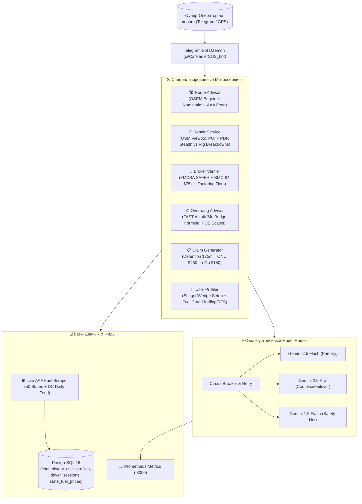

# 🚛 Грузовики на базу: Автономный AI-Диспатч & Лидогенерация

> **Единственная в США AI-диспетчерская для автовозов, говорящая на настоящем языке дороги, где водитель ВСЕГДА прав, а его деньги и CDL защищены законом.**

[-orange.svg)](#)

---

## 📌 1. Быстрые ссылки на систему (Quick Links)

| Ресурс | Ссылка | Назначение / Доступ |
| :--- | :--- | :--- |
| 📢 **Telegram-канал** | [`@trucks_to_base`](https://t.me/trucks_to_base) | Публичный канал сообщества, аналитика, алерты дорог и привлечение оунеров |
| 🤖 **Telegram AI-Бот** | [`@CarHaulerSOS_bot`](https://t.me/CarHaulerSOS_bot) | Экстренная помощь на дороге (маршрут, ремонт, брокеры, свесы, претензии) |
| 📊 **Grafana Dashboard** | [Live Executive Dashboard](https://grafana.194.127.179.231.sslip.io/d/dispatch-hub-analytics/dispatch-hub3a-driver-cases-and-operations) | Аналитика выбитых денег, статистика по кейсам и метрики моделей (`admin` / `GrafanaAdminSecure2026!`) |
| 📈 **Prometheus Metrics** | `http://194.127.179.231:8000/metrics` | Метрики Model Router (`gemini_requests_total`, `latency`, `errors`) |
| 🖥️ **Хостинг / Сервер** | `194.127.179.231` (Host: `trucker-dream`) | Clouvider Cloud VPS (Ubuntu 24.04 LTS, Docker Compose Stack) |

---

## 🎯 2. Бизнес-модель и Цели Проекта

### Суровая реальность автовозного бизнеса в США
Автовозный бизнес (Car Hauling) — один из самых высокодоходных, но и самых рискованных сегментов грузоперевозок. Оунер-оператор сталкивается с постоянным давлением:
1. **Неоплачиваемый простой (Detention):** Аукционы Copart, IAAI и Manheim маринуют автовоз на гейтах по 4–6 часов, а брокеры отказываются платить.
2. **Срывы погрузки (Dry Run / TONU):** Водитель проехал 100 миль дедхеда, а лот уже продан или заблокирован.
3. **Скрытые ин-опы (Inop):** Машина заявлена как "Runs & Drives", но по факту не заводится, колеса заблокированы, а лебежение никто не оплатил.
4. **Дабл-брокеринг и мошенники:** Скамеры перепродают чужие грузы через свежие MC и крадут оплату за фрейт.
5. **Ценовой прессинг на топливо:** Разница в цене солярки между штатами и колонками достигает $0.50–$1.50 за галлон (Орегон/Калифорния $6.75–$8.40 vs Техас $3.40).
6. **Повреждения груза и поломки оборудования:** Случайная царапина на клиентском авто грозит клеймом на Carfax и взлетом страховки, а лопнувший гидравлический шланг парализует погрузку.

### Наша стратегическая цель
Создать **автономный ИИ-хаб экстренной помощи автовозчикам**, который:
- Решает реальные дорожные проблемы оунера за 60 секунд.
- Выбивает деньги с брокеров (Detention, Dry Run, Inop fee).
- Защищает водителя от штрафов DOT, весовых проверок и скамеров.
- Предоставляет расчет маршрута, топлива и проверенных мастеров в реальном времени без захардкоженных цифр.
- **Главная конверсионная цель (Future Plans):** Демонстрацией железной защиты переводить оунер-операторов на наше постоянное диспетчерское обслуживание за **фиксированную комиссию 7%**.

---

## 🏛️ 3. Архитектура «Совет Агентов» & Микросервисы

Систему ведет отказоустойчивый автономный демон (`services/telegram_bot_daemon.py`), объединяющий специализированные модули под управлением **Совета Агентов** (Council of Agents):

### Состав Совета:
1. **⚖️ Агент-Юрист:** Знает Carmack Amendment, условия бонда брокера BMC-84 ($75,000), регламент счетов за простой ($75/час после 2 часов бесплатного ожидания) и TONU.
2. **🛠️ Агент-Техник:** Эксперт по габаритам и оборудованию — FAST Act (23 CFR § 658.13), Federal Bridge Formula B, развесовка по осям (Steer 12–20k, Drive 34k, Trailer 34k, Gross 80,000 lbs), высоты мостов (Восток 13'6", Запад 14'0"), гидравлика JIC 37° и сварка рамп 6061.
3. **🎧 Главный Диспетчер:** Ведет диалог от лица совета. Никаких нотаций, сухой академической нудятины или выдуманных советов. Профессиональный, четкий язык американских автовозчиков.

### Фундаментальное правило: «Водила ВСЕГДА прав»
Совет всегда защищает интересы оунера: предлагает безопасные тактические решения, исключающие риски для CDL, штрафы DOT и потерю денег при спорах с брокерами.

---

## 📱 4. Меню и Рабочие Функции Бота

Нативное меню команд Telegram (`setMyCommands`) синхронизировано со всеми сервисами:

### 1. 🛣️ `/route` — Анализ маршрута и солярки
* **Ввод:** Нажатие кнопки `📍 Отправить мою гео-точку` или ввод текста в любом формате (например, `1033 Green Acres Rd, Eugene OR в Dallas TX`).
* **Геометрия и пробег:** Автоматическая нормализация адресов через OpenStreetMap Nominatim и построение точного маршрута через OSRM.
* **Расход под сетап:**
  * Стингер 9-кар (Class 8): ~5.5 MPG (груженый) / ~6.5 MPG (пустой).
  * Хай-Маунт 7-кар: ~6.0 MPG.
  * Пикап + 3–4 авто Виджик: ~9.5 MPG.
* **Топливный арбитраж:** Автоматическое подключение суточного живого фида цен **AAA** по всем штатам на пути, расчет скидок по топливной карте водителя (Mudflap, RTS, TCS, NASTC) и чистой себестоимости с учетом IFTA.
* **Весовые:** Вывод контрольных станций взвешивания (POE Weigh Stations) по штатам следования.

### 2. 🔧 `/repair` — Мастер рядом (Свой трак / Авто клиента)
* **Прием локации:** Нативная GPS-точка из Telegram или адрес.
* **Поиск мастерских:** Динамический поиск через OpenStreetMap (Nominatim Bounded Viewbox) в радиусе происшествия.
* **Автоматическая классификация проблемы через Gemini:**
  * **Скрытый ремонт авто клиента (`cargo_stealth`):**
    * Ситуация: царапина, притертость, вмятина на перевозимой машине.
    * Протокол: Мобильный PDR (удаление вмятин без покраски), локальная микрополировка, расчет наличными/Zelle **без фиксации VIN в Carfax** и без страхового клейма. Инструкция по сопоставлению дорожной пыли и проверке eBOL.
  * **Поломка автовоза (`truck_rig`):**
    * Ситуация: лопнул гидравлический шланг, потек цилиндр, треснула алюминиевая аппарель.
    * Протокол: Подбор мобильных гидравлических сервисов (PIRTEK, Love's Truck Care, TA Truck Service), параметры фитингов (JIC 37° Flare, двухкосичные шланги 3000+ PSI), аргоновая сварка алюминия 6061 T6.

### 3. 🏢 `/broker` — Проверка брокера по MC#
* Проверка активности брокера и наличия действующего бонда **BMC-84 ($75,000)**.
* Оценка среднего срока оплаты (Days to Pay / DTP).
* Проверка факторингового аппрува (Apex Capital, RTS Financial, OTR Capital, Triumph).
* Выявление признаков дабл-брокеринга (бесплатная почта, недавняя смена реквизитов).

### 4. ⚖️ `/overhang` — Свесы и весы (FAST Act)
* Разрешенные свесы груза в соответствии с **23 CFR § 658.13**:
  * **Стингер (Stinger-steered):** 4 фута спереди (Front Overhang) и 6 футов сзади (Rear Overhang).
  * **Обычная сцепка / Хай-Маунт / Виджик:** 3 фута спереди, 4 фута сзади.
* Габариты по высоте: 13'6" (Восточные штаты) vs 14'0" (Западные штаты / STAA).
* Ограничения веса по Federal Bridge Formula B (20,000 lbs одиночная ось, 34,000 lbs тандем, 80,000 lbs Gross).
* Главные весовые станции штата (POE / Scale Houses).

### 5. 📋 `/claim` — Претензии в 1 клик
Интерактивные шаблоны с юридически обоснованным текстом для мгновенной пересылки брокеру в блоках `<code>...</code>`:
* **Detention ($75/час):** Расчет при ожидании на погрузке/выгрузке свыше 2 часов.
* **TONU / Dry Run ($250 / $200):** Компенсация холостого пробега при срыве рейса не по вине водителя.
* **In-Op Winch Fee ($150):** Доплата за неходовой автомобиль с заблокированными колесами.

### 6. 👤 `/profile` — Сетап и топливная программа
* Сохранение типа автовоза (Стингер 9-кар, Хай-Маунт, Пикап с виджиком).
* Привязка топливной карты (Mudflap, RTS, TCS, NASTC, EFS) и персональной скидки (по умолчанию -$0.45/gal).
* Учет предпочтительного коридора и загрузки при всех последующих расчетах.

---

## ⛽ 5. Топливный Модуль и Интеграция AAA

В системе полностью исключен хардкод цен на топливо:
* Сервис `services/aaa_fuel_feed.py` производит регулярный парсинг официальных данных **AAA (American Automobile Association)** по всем 50 штатам + округ Колумбия.
* Данные кэшируются в оперативной памяти и сохраняются в таблицу PostgreSQL `state_fuel_prices`.
* Точность данных проверена реальными дорожными ценами: расхождение между живым фидом AAA и розничной колонкой Chevron на трассе I-5 в Орегоне составляет **1 цент** ($6.74 против $6.75).
* Для экстренного поиска конкретных сетевых тракстопов подключен fallback через HERE Truck Fuel API с контролем бюджета расходов.

---

## ⚡ 6. Отказоустойчивый Model Router

Маршрутизатор моделей `services/model_router.py` обеспечивает 100% бесперебойность ответов:
* **Circuit Breaker:** Отслеживает процент ошибок API. При возникновении проблем автоматически переключает трафик на резервную модель.
* **Пул моделей:**
  1. `gemini-2.5-flash` — быстрая основная модель для генерации ответов и классификации.
  2. `gemini-2.5-pro` — резервная мощная модель для сложных аналитических запросов.
  3. `gemini-1.5-flash` — дополнительный уровень отказоустойчивости.
* **Prometheus-метрики:** На порту `8000/metrics` ведется учет общего числа запросов, времени ответа (Latency) и ошибок по каждой модели.

---

## 🔒 7. Безопасность и GDPR-Комплаенс

Перед записью диалогов и кейсов в базу данных активируется конвейер санитации:
* Номера телефонов маскируются (`[PHONE_REDACTED]`).
* Telegram-никнеймы заменяются на `[USER_REDACTED]`.
* 17-значные VIN обрезаются до последних 6 цифр (`VIN:***012345`), предотвращая утечку данных о клиентах.
* Все взаимодействия сохраняются в PostgreSQL (`chat_history`, `driver_cases`) для контекстной памяти дежурного диспетчера.

---

## 🚀 8. Планы Развития (Future Plans)

Следующие стратегические направления сохраняются в соответствии с дорожной картой проекта:
1. **Масштабирование диспетчерского флота:** Привлечение оунер-операторов на постоянный диспатч за **фиксированную комиссию 7%**.
2. **Интеграция с ELD и телематикой:** Автоматическое чтение оставшихся часов HOS (Hours of Service) для предотвращения нарушений DOT.
3. **Прямая интеграция с Central Dispatch:** Автоматический матчинг попутных автомобилей на пустые деки автовоза в реальном времени.
4. **Финансовый арбитраж факторинга:** Интеграция API факторинговых компаний для моментальной проверки кредитного лимита брокера прямо в кабине.
