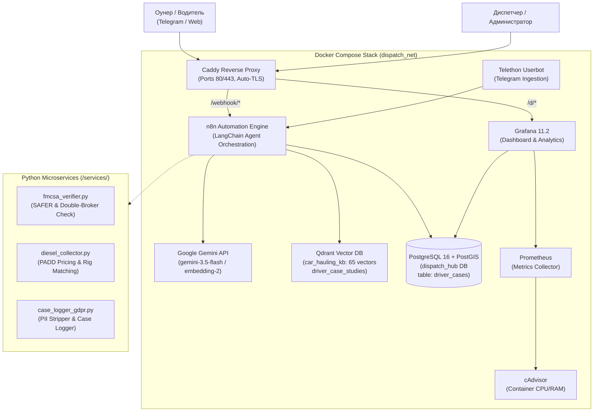

# 🛠️ Car Hauling Dispatch Hub — Техническая Архитектура & Руководство Инженера

> **Полное техническое руководство по инфраструктуре, микросервисам, базам данных, RAG-конвейеру и управлению параметрами через GitHub.**

---

## 📌 1. Сводная таблица доступов и эндпоинтов

| Сервис | Хост / URL | Порт (Docker) | Авторизация / Ключи |
| :--- | :--- | :--- | :--- |
| **Хостинг VPS** | `194.127.179.231` (Clouvider) | 22 (SSH) | `ssh -i clouvider_key.pem root@194.127.179.231` |
| **Reverse Proxy** | `Caddy 2` | 80, 443 | Автоматический TLS от Let's Encrypt / ZeroSSL |
| **Grafana Dashboard** | `https://grafana.194.127.179.231.sslip.io` | 3000 | `admin` / `GrafanaAdminSecure2026!` |
| **n8n Automation** | `https://n8n.194.127.179.231.sslip.io` | 5678 | Базовая авторизация n8n |
| **PostgreSQL 16 + PostGIS** | `postgres` (внутр. сеть) | 5432 | `dispatch_admin` / `DispatchSecurePass2026!_pg` (DB: `dispatch_hub`) |
| **Qdrant Vector DB** | `qdrant` (внутр. сеть) | 6333, 6334 | API-Key: `QdrantSecretKey2026!_vector` |
| **Prometheus** | `prometheus` (внутр. сеть) | 9090 | Метрики cAdvisor и контейнеров |
| **cAdvisor** | `cadvisor` (внутр. сеть) | 8080 | Экспорт статистики Docker (CPU, RAM, Network) |
| **Telegram Userbot** | `dispatch_telethon` | — | Telethon Session + Webhook в n8n |

---

## 🏗️ 2. Топология Инфраструктуры

Инфраструктура развернута на базе **Docker Compose** в изолированной bridge-сети `dispatch_net`. Весь внешний трафик маршрутизируется через Caddy Reverse Proxy с поддержкой HTTPS/TLS.



---

## 🤖 3. Конвейер AI, RAG и Векторные Базы

### 1. Используемые модели Google Gemini
* **Основная языковая модель чата:** `models/gemini-3.5-flash`
  * Высокий лимит (1,500 RPD на Free Tier), моментальный стриминг, нулевая задержка.
  * Патч n8n: В библиотеку `@google/generative-ai` внедрен безопасный парсер чанков для предотвращения ошибки `Failed to parse stream`.
* **Векторная модель эмбеддингов:** `models/gemini-embedding-2`
  * Размерность вектора: **3072 измерения**.
  * Метрика расстояния: **Cosine similarity**.

### 2. Коллекции в Qdrant
1. `car_hauling_kb` (65 векторных точек):
   * Векторизованные 13 профессиональных книг автовозного дела: Carmack Amendment, Bridge Formula B, AIAG M-22 damage codes, аукционы Copart/IAAI/Manheim, правила транспортировки электромобилей (EV).
   * Подключена как инструмент `car_hauling_knowledge_base` в n8n LangChain Agent.
2. `driver_case_studies`:
   * Векторная база прецедентов, разрешенных в пользу водителей.
   * Каждый кейс сохраняется после очистки от персональных данных (GDPR).

---

## 🗄️ 4. Схема Базы Данных PostgreSQL (`driver_cases`)

Для аналитики в Grafana и ведения статистики создана таблица `driver_cases`:

```sql
CREATE TABLE IF NOT EXISTS driver_cases (
    id SERIAL PRIMARY KEY,
    created_at TIMESTAMP WITH TIME ZONE DEFAULT NOW(),
    updated_at TIMESTAMP WITH TIME ZONE DEFAULT NOW(),
    driver_id VARCHAR(100),              -- Необратимый хэш (например, 'drv_c2564e')
    driver_setup VARCHAR(50) NOT NULL,   -- 'Stinger 9-car', 'High-Mount 7-car', 'Pickup + 3-4 car Wedge'
    category VARCHAR(50) NOT NULL,       -- 'Detention', 'Inop / Winch', 'TONU / Dry Run', etc.
    facility VARCHAR(100),               -- 'Copart', 'IAAI', 'Manheim', 'Private Dealer', 'POV'
    facility_location VARCHAR(100),      -- Например, 'Dallas, TX'
    state VARCHAR(10),                   -- Двухбуквенный код штата
    broker_name VARCHAR(150),            -- Наименование брокера
    broker_mc VARCHAR(30),               -- Номер MC (например, 'MC-582910')
    claimed_amount NUMERIC(10,2) DEFAULT 0.00,
    recovered_amount NUMERIC(10,2) DEFAULT 0.00,
    status VARCHAR(30) DEFAULT 'Resolved',
    time_to_resolve_minutes INT DEFAULT 30,
    sanitized_case_summary TEXT,         -- Обезличенное описание кейса (GDPR)
    resolution_strategy TEXT             -- Использованный юридический/технический плейбук
);

CREATE INDEX IF NOT EXISTS idx_driver_cases_created ON driver_cases(created_at);
CREATE INDEX IF NOT EXISTS idx_driver_cases_category ON driver_cases(category);
CREATE INDEX IF NOT EXISTS idx_driver_cases_status ON driver_cases(status);
CREATE INDEX IF NOT EXISTS idx_driver_cases_setup ON driver_cases(driver_setup);
CREATE INDEX IF NOT EXISTS idx_driver_cases_facility ON driver_cases(facility);
```

### Запросы, используемые в дашборде Grafana:
* **Общая сумма выбитых средств:**
  ```sql
  SELECT COALESCE(SUM(recovered_amount), 0) AS total_recovered FROM driver_cases;
  ```
* **Процент выигрыша споров (Win Rate %):**
  ```sql
  SELECT ROUND((COUNT(*) FILTER (WHERE recovered_amount > 0)::numeric / GREATEST(COUNT(*), 1) * 100), 1) AS win_rate FROM driver_cases;
  ```
* **Распределение по типу сцепки:**
  ```sql
  SELECT driver_setup, COUNT(*) AS cases_count FROM driver_cases GROUP BY driver_setup ORDER BY cases_count DESC;
  ```

---

## 🔒 5. Конвейер GDPR-Обезличивания (`case_logger_gdpr.py`)

Перед записью любого инцидента в базу данных и векторную память запускается конвейер санитации:
1. **Телефоны:** Регулярное выражение `(?:\+?1[-. ]?)?\(?([0-9]{3})\)?[-. ]?([0-9]{3})[-. ]?([0-9]{4})` $\to$ `[PHONE_REDACTED]`.
2. **Telegram Никнеймы:** `@[A-Za-z0-9_]{4,}` $\to$ `[USER_REDACTED]`.
3. **Электронные адреса:** `\b[A-Za-z0-9._%+-]+@[A-Za-z0-9.-]+\.[A-Z|a-z]{2,7}\b` $\to$ `[EMAIL_REDACTED]`.
4. **VIN-номера автомобилей:** Первые 11 символов 17-значного VIN заменяются на звездочки, сохраняя только контрольные цифры: `([A-HJ-NPR-Z0-9]{11})([A-HJ-NPR-Z0-9]{6})` $\to$ `VIN:***\2`.
5. **ID Водителя:** `md5(driver_id)[:6]` $\to$ необратимый хэш `drv_xxxxxx`.

---

## 🔄 6. Управление параметрами через GitHub и Hot-Reload

### 1. Файл `config.json`
Центральный файл конфигурации находится в корне репозитория и на сервере `/opt/dispatch-hub/config.json`:
```json
{
  "version": "1.1.0",
  "ai": {
    "chat_model": "models/gemini-3.5-flash",
    "fallback_model": "models/gemini-3.6-flash",
    "embedding_model": "models/gemini-embedding-2",
    "temperature": 0.2
  },
  "telegram": {
    "bot_username": "@CarHaulerSOS_bot",
    "public_channel": "@trucks_to_base",
    "admin_cabinet_id": "-1002345678901"
  },
  "business_rules": {
    "commission_rate_percent": 7.0,
    "dry_run_auction_standard": 250,
    "dry_run_dealer_standard": 200,
    "detention_hourly_rate": 75,
    "grace_period_hours": 2
  }
}
```

### 2. Механизм Hot-Reload без перезапуска контейнеров
Скрипт `scripts/sync_github_config.py` реализует мгновенное применение правок из GitHub:
1. Выполняет `git pull origin main` (или скачивает `config.json` по Raw URL).
2. Читает обновленные параметры `ai.chat_model`, `temperature`, `business_rules`.
3. Напрямую в PostgreSQL обновляет JSON-дерево нод `workflow_entity` (ID `aiDispatchAgent01`).
4. При следующем сообщении водителя n8n использует **новые параметры без остановки контейнера**.

### 3. Автоматизация через Cron
Для периодической проверки обновлений из GitHub на сервере настраивается cron-задача:
```bash
# Проверка обновлений каждые 5 минут
*/5 * * * * /opt/dispatch-hub/scripts/sync_github_config.sh >> /var/log/dispatch_sync.log 2>&1
```

---

## 🚀 7. Руководство по развертыванию с нуля

### Шаг 1: Клонирование репозитория
```bash
git clone https://github.com/YOUR_ORGANIZATION/car-hauling-dispatch-hub.git /opt/dispatch-hub
cd /opt/dispatch-hub
```

### Шаг 2: Настройка переменных окружения
```bash
cp .env.example .env
nano .env  # Укажите реальные пароли, ключи Gemini и субдомены
```

### Шаг 3: Запуск стека Docker Compose
```bash
docker compose up -d
docker ps  # Все 8 контейнеров должны иметь статус Up / healthy
```

### Шаг 4: Инициализация БД PostgreSQL
```bash
docker exec -i dispatch_postgres psql -U dispatch_admin -d dispatch_hub < scripts/init_driver_cases.sql
```

### Шаг 5: Проверка статуса сервисов
```bash
# Проверка источников данных Grafana
docker exec dispatch_grafana curl -s -u admin:GrafanaAdminSecure2026! http://localhost:3000/api/datasources

# Проверка Qdrant коллекций
python3 services/diesel_collector.py "Stinger 9-car"
python3 services/fmcsa_verifier.py "MC-123456"
```
