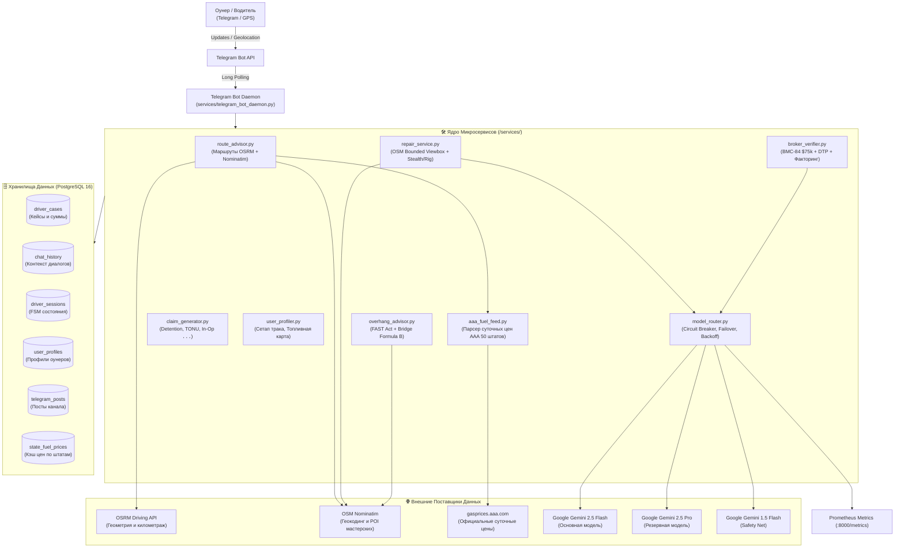

# 🛠️ Car Hauling Dispatch Hub — Техническая Архитектура & Руководство Инженера

> **Полное техническое руководство по инфраструктуре, микросервисам, базам данных, конвейеру маршрутизации ИИ, интеграциям OpenStreetMap/OSRM и мониторингу.**

---

## 📌 1. Сводная таблица сервисов и эндпоинтов

| Сервис | Хост / URL | Порт | Назначение / Ключи |
| :--- | :--- | :--- | :--- |
| **Хостинг VPS** | `194.127.179.231` (Clouvider) | 22 (SSH) | `ssh -i clouvider_key.pem root@194.127.179.231` |
| **Telegram Bot Daemon** | Контейнер `dispatch_bot` | 8000 | `@CarHaulerSOS_bot` (Python 3.12 Daemon, Bot API, Prometheus метрики) |
| **Reverse Proxy** | `Caddy 2` | 80, 443 | Автоматический TLS от Let's Encrypt / ZeroSSL |
| **Grafana Dashboard** | `https://grafana.194.127.179.231.sslip.io` | 3000 | `admin` / `GrafanaAdminSecure2026!` (Dashboard `dispatch-hub-analytics`) |
| **Prometheus (Router)** | `http://194.127.179.231:8000/metrics` | 8000 | Экспорт метрик Model Router (`gemini_requests_total`, `gemini_latency_seconds`) |
| **Prometheus (Server)** | `prometheus` (внутр. сеть) | 9090 | Сбор метрик cAdvisor и Docker контейнеров |
| **cAdvisor** | `cadvisor` (внутр. сеть) | 8080 | Экспорт статистики Docker (CPU, RAM, Сеть) |
| **PostgreSQL 16 + PostGIS** | `postgres` (внутр. сеть) | 5432 | `dispatch_admin` / `DispatchSecurePass2026!_pg` (DB: `dispatch_hub`) |
| **Qdrant Vector DB** | `qdrant` (внутр. сеть) | 6333, 6334 | API-Key: `QdrantSecretKey2026!_vector` (Коллекция: `car_hauling_kb`) |
| **News & Alerts Engine** | `dispatch_bot` (PID 8) | — | Автономный мониторинг дорожных перекрытий и генерация постов в канал |

---

## 🏗️ 2. Топология Архитектуры

Инфраструктура развернута на базе **Docker Compose** в изолированной bridge-сети `dispatch_net`. Весь внешний трафик веб-панелей маршрутизируется через Caddy Reverse Proxy с поддержкой HTTPS/TLS, а бот работает через длинный поллинг Telegram Bot API.



---

## 🤖 3. Реализация Модулей и Бизнес-Логики

### 1. Маршруты и Солярка (`services/route_advisor.py`)
* **Геокодирование:** Разрешение географических названий и адресов через Nominatim OpenStreetMap с нативной обработкой GPS-координат.
* **Маршрутизация:** Запрос к OSRM (`router.project-osrm.org/route/v1/driving/`) для вычисления точного расстояния в милях и списка пересекаемых штатов.
* **Расход под сетап:**
  * Стингер 9-кар: $5.5\text{ MPG}$ (груженый) / $6.5\text{ MPG}$ (пустой).
  * Хай-Маунт: $6.0\text{ MPG}$.
  * Пикап + 3–4 авто Виджик: $9.5\text{ MPG}$.
* **Интеграция AAA и карт:** Извлечение средних суточных цен из PostgreSQL `state_fuel_prices`, применение скидки по топливной карте водителя (Mudflap, RTS, TCS) и расчет IFTA Net Cost.

### 2. Мастер рядом (`services/repair_service.py`)
* **Прием гео-точки:** Нативная кнопка `📍 Отправить мою гео-точку` (`request_location: True`) или текст.
* **Поиск мастерских:** Запрос к Nominatim с фильтром по ограничивающему прямоугольнику (`viewbox=[min_lon, max_lat, max_lon, min_lat]&bounded=1`).
* **Классификация запроса (Gemini):**
  * `cargo_stealth`: Повреждения перевозимых автомобилей (PDR, беспокрасочный ремонт, локальная полировка, оплата Cash/Zelle без внесения VIN в базу Carfax, сверка eBOL).
  * `truck_rig`: Поломки самого автовоза (шланги гидравлики JIC 37°, аргоновая сварка 6061 T6, круглосуточный коммерческий роудсайд PIRTEK, Love's Truck Care, TA Truck Service).

### 3. Проверка брокера (`services/broker_verifier.py`)
* Проверка компании по MC-номеру через отказоустойчивый Model Router.
* Контроль активности бонда BMC-84 (\$75,000), условий факторинга (Tier 1: Apex, RTS, OTR Capital), сроков оплаты (DTP) и признаков дабл-брокеринга.

### 4. Свесы и весы (`services/overhang_advisor.py`)
* Федеральный закон **FAST Act (23 CFR § 658.13)**:
  * Стингер: 4 фута спереди / 6 футов сзади.
  * Виджик / Традиционная сцепка: 3 фута спереди / 4 фута сзади.
* Предельная высота: 13'6" (Восток) против 14'0" (Запад).
* Контроль веса по Federal Bridge Formula B (20k/34k/80k lbs) и вывод ключевых весовых станций штата (POE Scales).

### 5. Шаблоны претензий (`services/claim_generator.py`)
* Генерация готовых юридических писем брокеру в тегах `<code>...</code>` для копирования в 1 клик:
  * **Detention:** \$75/час после 2 часов бесплатного окна.
  * **TONU / Dry Run:** \$250 (Copart/IAAI/Manheim), \$200 (дилеры).
  * **In-Op:** \$150 за лебежение.

### 6. Отказоустойчивый Model Router (`services/model_router.py`)
* Автоматический Failover: `gemini-2.5-flash` $\to$ `gemini-2.5-pro` $\to$ `gemini-1.5-flash`.
* Встроенный Circuit Breaker (предохранитель от каскадных сбоев) с экспоненциальной задержкой.
* Экспорт метрик на порт `8000/metrics` для Prometheus и Grafana.

---

## 🗄️ 4. Схема Базы Данных PostgreSQL (`dispatch_hub`)

```sql
-- 1. Кейсы водителей и финансовая аналитика
CREATE TABLE IF NOT EXISTS driver_cases (
    id SERIAL PRIMARY KEY,
    created_at TIMESTAMP WITH TIME ZONE DEFAULT NOW(),
    updated_at TIMESTAMP WITH TIME ZONE DEFAULT NOW(),
    driver_id VARCHAR(100),              -- Необратимый хэш (например, 'drv_c2564e')
    driver_setup VARCHAR(50) NOT NULL,   -- 'Stinger 9-car', 'Pickup + Wedge', etc.
    category VARCHAR(50) NOT NULL,       -- 'Detention', 'Inop', 'TONU'
    facility VARCHAR(100),               -- 'Copart', 'Manheim', 'Dealer'
    facility_location VARCHAR(100),
    state VARCHAR(10),
    broker_name VARCHAR(150),
    broker_mc VARCHAR(30),
    claimed_amount NUMERIC(10,2) DEFAULT 0.00,
    recovered_amount NUMERIC(10,2) DEFAULT 0.00,
    status VARCHAR(30) DEFAULT 'Resolved',
    time_to_resolve_minutes INT DEFAULT 30,
    sanitized_case_summary TEXT,
    resolution_strategy TEXT
);

-- 2. История диалогов дежурного диспетчера
CREATE TABLE IF NOT EXISTS chat_history (
    id SERIAL PRIMARY KEY,
    chat_id BIGINT NOT NULL,
    role VARCHAR(16) NOT NULL,           -- 'user' | 'model'
    message TEXT NOT NULL,
    created_at TIMESTAMP WITH TIME ZONE DEFAULT NOW()
);

-- 3. Состояния интерактивных сценариев (FSM)
CREATE TABLE IF NOT EXISTS driver_sessions (
    chat_id BIGINT PRIMARY KEY,
    state VARCHAR(64) NOT NULL DEFAULT 'idle',
    last_query TEXT,
    updated_at TIMESTAMP WITH TIME ZONE DEFAULT NOW()
);

-- 4. Профили водителей (сетап и топливная карта)
CREATE TABLE IF NOT EXISTS user_profiles (
    chat_id BIGINT PRIMARY KEY,
    truck_type VARCHAR(64) DEFAULT 'Стингер 9-кар (Class 8)',
    typical_cargo VARCHAR(64) DEFAULT 'Груженый',
    fuel_card VARCHAR(64) DEFAULT 'Mudflap',
    fuel_discount NUMERIC(4,2) DEFAULT 0.45,
    primary_corridor VARCHAR(64) DEFAULT 'I-10 / I-40 / I-80',
    updated_at TIMESTAMP WITH TIME ZONE DEFAULT NOW()
);

-- 5. Посты публичного канала и согласование в кабинете
CREATE TABLE IF NOT EXISTS telegram_posts (
    post_id SERIAL PRIMARY KEY,
    created_at TIMESTAMP WITH TIME ZONE DEFAULT NOW(),
    source_url VARCHAR(500),
    title VARCHAR(300),
    summary TEXT,
    content TEXT NOT NULL,
    category VARCHAR(50),
    severity VARCHAR(20) DEFAULT 'normal',
    status VARCHAR(30) DEFAULT 'pending_approval',
    cabinet_message_id BIGINT,
    target_channel VARCHAR(100) DEFAULT '@trucks_to_base'
);

-- 6. Живой суточный фид цен на топливо от AAA
CREATE TABLE IF NOT EXISTS state_fuel_prices (
    state_code VARCHAR(8) PRIMARY KEY,
    state_name VARCHAR(64) NOT NULL,
    diesel_price NUMERIC(5,3) NOT NULL,
    regular_price NUMERIC(5,3),
    source VARCHAR(32) DEFAULT 'AAA',
    updated_at TIMESTAMP WITH TIME ZONE DEFAULT NOW()
);
```

---

## 🔒 5. Конвейер Безопасности & GDPR-Санитация

Перед сохранением любого диалога или кейса выполняется очистка от персональных данных:
1. **Телефоны:** Регулярное выражение `(?:\+?1[-. ]?)?\(?([0-9]{3})\)?[-. ]?([0-9]{3})[-. ]?([0-9]{4})` $\to$ `[PHONE_REDACTED]`.
2. **Telegram Никнеймы:** `@[A-Za-z0-9_]{4,}` $\to$ `[USER_REDACTED]`.
3. **VIN-номера автомобилей:** Первые 11 символов 17-значного VIN маскируются: `([A-HJ-NPR-Z0-9]{11})([A-HJ-NPR-Z0-9]{6})` $\to$ `VIN:***\2`.
4. **Хэширование водителей:** Идентификатор чата преобразуется в необратимый вид `drv_xxxxxx`.

---

## 🚀 6. Руководство по Развертыванию и Запуску

### Запуск сервисов на боевом VPS:
```bash
# Подключение к серверу
ssh -i clouvider_key.pem root@194.127.179.231

# Переход в директорию проекта
cd /opt/dispatch-hub

# Перезапуск контейнера бота после обновлений кодовой базы
docker restart dispatch_bot

# Проверка логов запуска и регистрации команд setMyCommands
docker logs --tail 40 dispatch_bot
```

### Проверка метрик Prometheus:
```bash
curl -s http://localhost:8000/metrics | grep gemini_
```

---

## 🔮 7. Планы Развития Архитектуры (Future Plans)

* Интеграция с официальными API телематики (Samsara / KeepTruckin) для проактивного мониторинга HOS (Hours of Service).
* Прямое подключение к Central Dispatch API для авто-подбора попутных грузов.
* Расширение аналитического дашборда Grafana финансовыми когортами по оунерам на фиксированной комиссии 7%.
