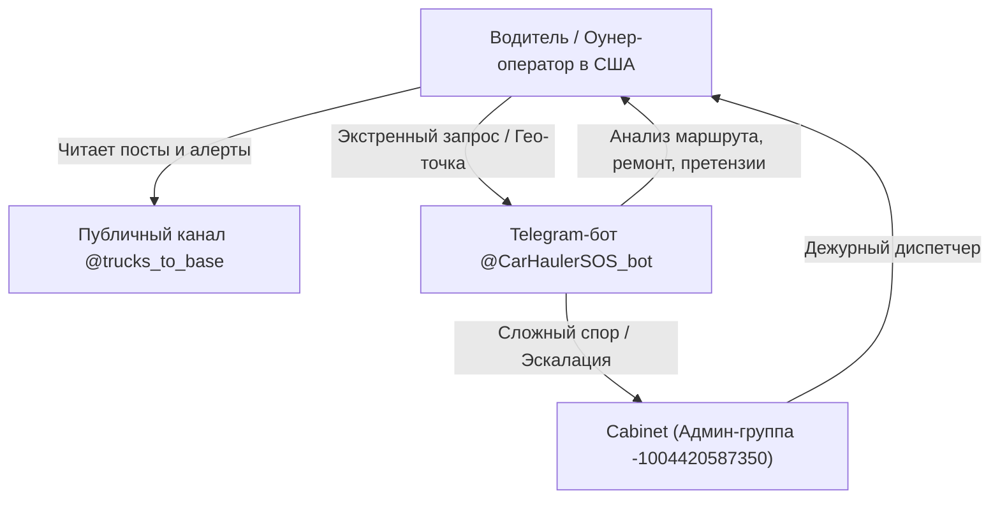

# Архитектура Telegram-бота @CarHaulerSOS_bot и рабочие каналы связи

Данный документ консолидирует служебные параметры, конфигурацию Telegram-бота и структуру каналов связи экосистемы диспетчерского обслуживания «Грузовики на базу».

---

## 1. Служебные параметры Telegram-бота

- **Bot Username:** [@CarHaulerSOS_bot](https://t.me/CarHaulerSOS_bot)
- **Назначение:** Круглосуточная дорожная помощь водителям и оунер-операторам автовозов (анализ маршрута, поиск мастеров, проверка брокеров, свесы по FAST Act, генерация претензий).
- **API Token:** Переменная окружения `TELEGRAM_BOT_TOKEN` в файле `.env` контейнера `dispatch_bot`.
- **Документация Bot API:** [https://core.telegram.org/bots/api](https://core.telegram.org/bots/api)

### Актуальное меню команд бота (`setMyCommands`):
* 🛣️ `/route` — **Анализ маршрута и солярки:** расчет миль через OSRM, расход по сетапу (Стингер 5.5 MPG, Виджик 9.5 MPG), живой фид цен AAA по штатам, скидки по топливной карте (Mudflap, RTS, TCS) и весовые POE.
* 🔧 `/repair` — **Мастер рядом:** геолокация по кнопке или адресу, разделение на скрытый ремонт клиентских авто (PDR/царапины без Carfax) и поломки автовоза (гидравлика JIC 37°, сварка рамп 6061, роудсайд 24/7).
* 🏢 `/broker` — **Проверка брокера по MC#:** статус в FMCSA SAFER, $75,000 BMC-84 бонд, дни оплаты (DTP) и факторинг (Apex, RTS, OTR Capital).
* ⚖️ `/overhang` — **Свесы и весы (FAST Act):** нормы 4ft/6ft для Стингера и 3ft/4ft для Виджика (23 CFR § 658.13), высоты 13'6"/14'0", развесовка по осям и активные весовые станции.
* 📋 `/claim` — **Шаблоны претензий:** готовые юридические тексты `<code>...</code>` в один клик для Детеншена ($75/ч), TONU ($250/$200) и In-Op ($150).
* 👤 `/profile` — **Мой сетап и топливная карта:** интерактивный выбор типа сцепки, скидочной программы и коридора.
* 🚛 `/start` — Главное меню диспетчера с постоянной клавиатурой быстрого доступа.
* 🆘 `/help` — Справка дежурного диспетчера.

> [!CAUTION]
> **Безопасность токена**
> Токен бота предоставляет полный доступ к управлению ботом. Храните его исключительно в защищенных переменных окружения (`.env`) и не публикуйте в открытых репозиториях.

---

## 2. Рабочие каналы связи и структура групп

1. **Административная группа с топиками (Cabinet Admin Group):**
   - **ID группы:** `-1004420587350`
   - **Назначение:** Внутренняя координация диспетчеров, согласование постов новостей и алертов перед публикацией, обработка эскалаций от водителей.

2. **Публичный информационный канал:**
   - **Username:** [`@trucks_to_base`](https://t.me/trucks_to_base)
   - **ID канала:** `-1004424371115`
   - **Назначение:** Публикация оперативных дорожных алертов, новостей рынка автовозов, аналитики ставок и привлечение оунер-операторов на диспетчерское обслуживание.

---

## 3. Схема взаимодействия в экосистеме

