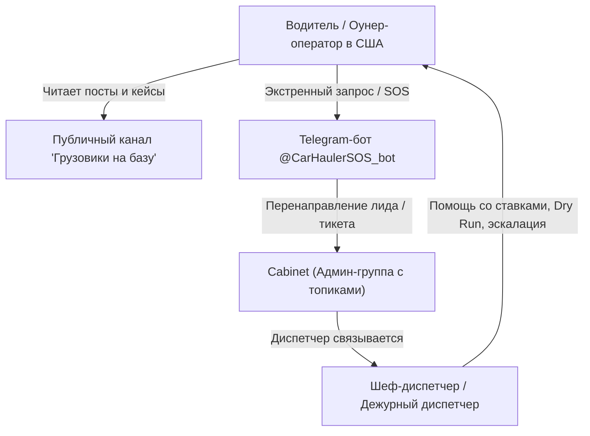

# Архитектура Telegram-бота @CarHaulerSOS_bot и рабочие каналы связи

Данный документ консолидирует служебные параметры, конфигурацию Telegram-бота и структуру каналов связи экосистемы диспетчерского обслуживания «Грузовики на базу». ---

## 1. Служебные параметры Telegram-бота

- **Bot Username:** [@CarHaulerSOS_bot](https://t.me/CarHaulerSOS_bot)
- **Назначение:** Первичная обработка обращений водителей и оунер-операторов, экстренная помощь на дорогах (SOS / Dry Run / Detention), сбор первичной информации для диспетчерской службы.
- **API Token:** `9152194119:AAG8pEBzYjWfESxabI-XsqvarM5Tv1PiO2w`
- **Документация Bot API:** [https://core.telegram.org/bots/api](https://core.telegram.org/bots/api)

> [!CAUTION]
> **Безопасность токена**
> Токен бота предоставляет полный доступ к управлению ботом. Храните его в защищенных переменных окружения (`.env`) и не публикуйте в открытых репозиториях.

---

## 2. Рабочие каналы связи и структура групп

1. **Административная группа с топиками:**
- Ссылка: [Cabinet Admin Group](https://web.telegram.org/a/#-1004420587350_1)
- ID группы: `-1004420587350`
- Структура: Внутренняя координация диспетчеров, оперативные алерты, обработка тикетов от водителей, разделение по топикам (SOS, Проверка брокеров, Аукционы, Бухгалтерия).

2. **Публичный информационный канал:**
- Ссылка: [Грузовики на базу (Public)](https://web.telegram.org/a/#-1004424371115)
- ID канала: `-1004424371115`
- Назначение: Публикация полезного контента для русскоязычных водителей автовозов в США, разборы сложных кейсов, предупреждения о мошенниках, воронка привлечения оунер-операторов на диспетчерское обслуживание. ---

## 3. Схема взаимодействия в экосистеме

